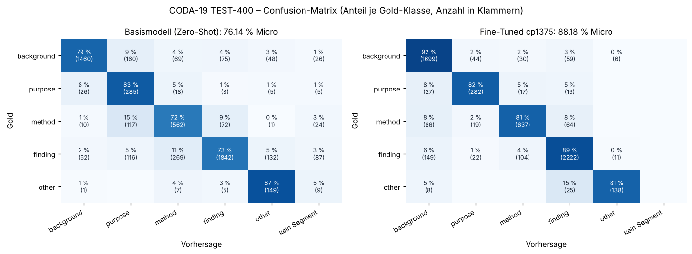

# CODA-19 – Segmentierung und Klassifikation wissenschaftlicher Abstracts mit Qwen3.5-4B

## Summary (English)

This project fine-tunes Qwen3.5-4B with QLoRA to analyse scientific abstracts as running text: the model splits each abstract into segments on its own, assigns every segment one of five research aspects (background, purpose, method, finding, other) and justifies each label with a reference to the matching rule in a codebook. The data comes from CODA-19 (Huang et al., 2020), around 11,000 English abstracts from the COVID-19 Open Research Dataset, annotated by crowd workers with nine annotators per abstract and labels set by majority vote. Segments and labels were kept unchanged; the codebook references were added with DeepSeek, which received the fixed human label and only selected the matching rule.

On 400 held-out test abstracts with 5,645 segments, the fine-tuned model classifies 88.2% of the segments correctly, compared with 76.1% for the base model, which halves the error rate. When segment boundaries and label must both match, the fine-tuned model reaches 87.4% against 22.7% for the base model, reproduces the segment text verbatim in all 400 abstracts and produces no invalid output. The test abstracts were never trained on, but their eval loss was tracked during training and the checkpoint with the lowest value was selected. The results were therefore confirmed on a separate dev set that played no role in training or checkpoint selection: there, the fine-tuned model reaches 86.6% against 78.9% for the base model with its best prompt variant, and 85.7% against 26.6% when boundaries are included.

As is common with crowd-annotated data, the gold labels contain some noise: according to the original study, crowd labels agree with experts on 82.2% of segments, and experts agree with each other on 85.0%. The remaining errors lie mostly between neighbouring aspects, and in a manual sample some of the model's predictions are more plausible than the gold label (section 5). Training ran on a rented RTX 3090 for about 22 hours with LoRA rank 96 and alpha 192; the evaluated checkpoint is step 1,375. The full documentation, including data preparation, evaluation and error analysis, follows below in German.

---

**Kurzfassung**

- **Aufgabe:** Qwen3.5-4B (QLoRA) erhält ein wissenschaftliches Abstract als Fließtext, zerlegt es selbst in Segmente, ordnet jedes einem von fünf Forschungsaspekten zu und verweist auf die passende Codebuch-Stelle.
- **Ergebnis auf 400 Test-Abstracts:** 76,14 % → **88,18 %** richtig klassifizierte Segmente (Basismodell → Fine-Tuned).
- **Mit Segmentierung bewertet** (Grenzen und Label müssen stimmen): 22,7 % → **87,4 %**.
- **Segmenttext:** in allen 400 Abstracts wörtlich und lückenlos wiedergegeben.
- **Zum Vergleich:** SciBERT bei Huang et al. (2020) erreicht auf vorsegmentiertem Text 74,9 % – nicht direkt vergleichbar, siehe Abschnitt 6.

## 1. Projektvorstellung

Für dieses Fine-Tuning-Projekt wurde ein Qwen3.5-4B-Modell ausgewählt und im Zuge eines Low-Rank-Adaptation-Fine-Tunings (QLoRA) so abgestimmt, dass es folgende Aufgabe bewältigt. Input für das Netz ist ein Abstract aus dem Datensatz CODA-19 (Huang et al., 2020): 10.966 englischsprachige Abstracts aus dem COVID-19 Open Research Dataset (CORD-19), von Laien über Amazon Mechanical Turk annotiert, je neun Annotatoren pro Abstract, Label per Mehrheitsentscheid. Jedes Segment trägt einen von fünf Forschungsaspekten: Hintergrund, Ziel, Methode, Ergebnis, Sonstiges. Huang et al. haben auf diesem Datensatz vorsegmentierten Text mit Modellen wie SciBERT klassifiziert. Ich wollte einen generativen Klassifikator auf diesem Set ausprobieren und dabei insbesondere die Segmentierung mit einbeziehen: Das Netz erhält das Abstract als Fließtext und muss die Segmentgrenzen selbst finden. Der strukturierte Output, also das Target, das das Netz lernen sollte: das Abstract in Segmente zu unterteilen, die einzelnen Segmente zu klassifizieren und jede Klassifikation mit einem Verweis auf die zugehörige Regel im Codebuch zu belegen.

Im Zuge meiner Versuchsreihe zu generativen Klassifikatoren (Generative Classifiers) steht das Konzept, dass eine textbasierte Klassifikation stattfindet, die die Klassifikation darüber hinaus in einem generativen Anteil begründet und belegt – in diesem Projekt über den Verweis auf die angewendete Codebuch-Regel. Da sich viele meiner Projekte bis zu diesem Zeitpunkt um synthetische Daten gedreht haben, war es in diesem Projekt meine explizite Absicht, meine Erfahrungen mit Generative Classifiers auch auf reale, von Menschen annotierte Daten zu übertragen.

Die Evaluierung des Trainings ergab auf dem Test-Set, 400 zurückgehaltenen Abstracts aus CODA-19 (höchstens 30 Segmente, keine Überschneidung mit dem Training), eine Genauigkeit von 87,32 % gemittelt über die Abstracts und 88,18 % über alle 5.645 einzelnen Segmente. Das Basismodell erreichte auf denselben Abstracts 75,26 % bzw. 76,14 %. Die Feinabstimmung bringt damit einen Zugewinn von 12,1 Prozentpunkten. Zusätzlich wurde das Basismodell auf einem Dev-Set mit mehreren Prompt-Varianten getestet, um es zu optimieren; auch gegenüber der besten Variante liegt das feinabgestimmte Modell deutlich vorn (Abschnitt 4).

## 2. Daten

**Quelle:** CODA-19. Segmente und Labels stammen unverändert aus dem Datensatz, sind also von Menschen gesetzt. Grundlage ist ein Pool von 9.450 Abstracts mit höchstens 30 Segmenten. Sehr lange Abstracts wurden ausgeschlossen, weil sie im Training zu viel Speicher brauchten.

**Ergänzung der Begründung:** CODA-19 enthält zu jedem Segment nur das Label, keine Begründung. Für das Target wurde deshalb ein drittes Feld ergänzt, `decision_reference`: der Verweis auf die Stelle im Codebuch, die das Label begründet. Das Codebuch beschreibt zu jedem der fünf Aspekte eine Definition, Regeln und Abgrenzungen zu benachbarten Aspekten. Gefüllt hat das Feld DeepSeek: Es erhielt Segment, festes Gold-Label und Codebuch und sollte die passende Codebuch-Stelle wörtlich heraussuchen. Labels ändern oder neu segmentieren durfte es nicht; die menschliche Annotation blieb unangetastet. Für das Training wurde die wörtliche Passage anschließend durch ein Kürzel ersetzt, das den Codebuch-Eintrag benennt (z. B. `finding.rule`, `background.definition`), um die Targets kürzer zu halten. Der System-Prompt wurde dabei nicht angepasst und verlangt weiterhin die wörtliche Passage; gelernt wird das Kürzel. Im Trainings-Set kommen 16 verschiedene Kürzel vor; 31 von rund 83.000 Segmenten haben ein leeres oder unregelmäßiges Kürzel.

**Aufteilung:**

| Set | Abstracts | Segmente | Herkunft | Verwendung |
|---|---|---|---|---|
| Train | 6.000 | 83.232 | Pool | Training |
| Test | 400 | 5.645 | Pool, disjunkt zu Train | Eval-Loss im Training, Endauswertung |
| Dev | 181 | 2.488 | 200 Abstracts außerhalb des Pools, begrenzt auf höchstens 25 Segmente | Auswertung, Vergleich der Prompt-Varianten des Basismodells |

Zwischen den drei Sets gibt es keine Überschneidung (geprüft über `paper_id`).

**Lizenz der Daten:** Weder das Paper noch das Repository von CODA-19 ([windx0303/CODA-19](https://github.com/windx0303/CODA-19)) nennen eine Lizenz. Die Abstracts stammen aus CORD-19 und unterliegen den Lizenzen der jeweiligen Originalveröffentlichungen. Die Dateien in `data/` sind eine für dieses Projekt aufbereitete Fassung und liegen hier nur zur Nachvollziehbarkeit der Ergebnisse; alle Rechte verbleiben bei den jeweiligen Inhabern.

**Verteilung der Labels im Trainings-Set (Segmente):**

| Label | Segmente |
|---|---|
| finding | 37.756 |
| background | 26.968 |
| method | 11.445 |
| purpose | 4.830 |
| other | 2.233 |

**Format:** Jedes Beispiel besteht aus System-Prompt (Aufgabe und Definitionen der fünf Aspekte), User-Nachricht (Abstract als Fließtext plus kurze Abgrenzungsregeln zwischen benachbarten Aspekten) und Target. Das Target ist ein JSON-Objekt mit einer Liste von Segmenten, je mit `segment_text` (wörtlicher Ausschnitt aus dem Abstract), `label`, `decision_reference` und `id`.

**Beispiel:** ein vollständiges Trainingsbeispiel, ausgewählt als eines der kürzesten mit mehreren Aspekten (`paper_id` d84f1c90…). Das Modell erhält System-Prompt und User-Nachricht und soll das Target erzeugen.

*Input (User-Nachricht, gekürzt um die Abgrenzungsregeln):*

```text
ABSTRACT:
African swine fever virus is transmissible through animal consumption of contaminated feed . To determine virus survival during transoceanic shipping , we calculated the half-life of the virus in 9 feed ingredients exposed to 30-day shipment conditions . Half-lives ranged from 9.6 to 14.2 days , indicating that the feed matrix environment promotes virus stability .

BOUNDARY RULES (apply when two aspects are close):
{ … sechs Abgrenzungsregeln, siehe unten … }

Return the JSON object now.
```

*Target:*

```json
{
  "segments": [
    {
      "segment_text": "African swine fever virus is transmissible through animal consumption of contaminated feed .",
      "label": "background",
      "decision_reference": "background.definition",
      "id": 1
    },
    {
      "segment_text": "To determine virus survival during transoceanic shipping ,",
      "label": "purpose",
      "decision_reference": "purpose.rule",
      "id": 2
    },
    {
      "segment_text": "we calculated the half-life of the virus in 9 feed ingredients exposed to 30-day shipment conditions .",
      "label": "method",
      "decision_reference": "method.rule",
      "id": 3
    },
    {
      "segment_text": "Half-lives ranged from 9.6 to 14.2 days ,",
      "label": "finding",
      "decision_reference": "finding.rule",
      "id": 4
    },
    {
      "segment_text": "indicating that the feed matrix environment promotes virus stability .",
      "label": "finding",
      "decision_reference": "finding.definition",
      "id": 5
    }
  ]
}
```

Der Satz „To determine virus survival …, we calculated the half-life …“ wird in zwei Segmente zerlegt, weil sich die Funktion mitten im Satz ändert: erst Ziel (`purpose`), dann Vorgehen (`method`).

<details>
<summary>System-Prompt und Abgrenzungsregeln vollständig</summary>

*System-Prompt:*

```text
You are a precise annotator for scientific abstracts. You receive a COMPLETE abstract as running text. Your task has two steps:

1. SEGMENT: Split the abstract into consecutive segments (clauses). A segment is the smallest unit that carries its own rhetorical function. A sentence may split into several segments when its function changes. The segments must cover the original text without gaps or overlaps.

2. LABEL: Assign each segment exactly one of five research aspects:
- background: known context, motivation, problem, prior state of research.
- purpose: the concrete aim, research question, or hypothesis of THIS work.
- method: how the work was carried out (procedure, materials, data, analysis).
- finding: results, outcomes, conclusions, implications of THIS work.
- other: anything with no research function (boilerplate, copyright, metadata, broken fragments).

Classify by the rhetorical FUNCTION of the segment, not by its subject matter.

Output: Return ONLY a JSON object with the key 'segments', an ordered list. Each segment is an object with the fields in EXACTLY this order:
- 'segment_text': the verbatim text span of this segment,
- 'label': one of [background, purpose, method, finding, other],
- 'decision_reference': the verbatim codebook passage (an aspect's rule/definition or a boundary_rule) that justifies the label; reference the codebook, do NOT quote the abstract.
- 'id': running number starting at 1 (int).

NO other fields, NO text outside the JSON. The order of segments must match their order in the abstract.
```

*Abgrenzungsregeln (Teil jeder User-Nachricht):*

```text
BOUNDARY RULES (apply when two aspects are close):
{
  "boundary_rules": {
    "background_vs_purpose": "background = what the world already knows / why the problem matters. purpose = what THIS study concretely intends. For 'understanding X is critical to ...' decide whether it is general motivation (background) or an explicit aim statement (purpose).",
    "purpose_vs_finding": "purpose usually comes early and is intent ('we aim to'). finding usually comes late and is a result ('we found'). Future/infinitive -> purpose; past tense/result -> finding.",
    "method_vs_finding": "method = the procedure (what was done). finding = the result (what came out). KEY TRAP: a clause that names an assay/analysis/instrument but states what it SHOWED is finding, not method. 'results indicated...', 'IHC showed...', 'X was generated for four strains' -> finding. 'X was measured using Y' (no result) -> method.",
    "background_vs_finding": "background = established prior knowledge or a general mechanism that holds regardless of this study. finding = a new result/observation of THIS work. A clause describing how something generally works (e.g. 'BCRs are assembled by recombination', 'nanoparticles target locations by...') is background, even if technical -> background.",
    "method_vs_purpose": "method = an action already carried out ('samples were examined for X', 'a consensus conference was sponsored'). purpose = a stated intention/aim ('to define the action steps', 'we aimed to'). Past-tense action -> method; infinitive of intent / aim statement -> purpose.",
    "finding_vs_other": "finding = any substantive result, conclusion, or implication of the work, INCLUDING future applications and limitations ('the model could be used for other diseases', 'discrepancies occurred when...'). other = ONLY non-research text (copyright, metadata, URLs, garbled fragments). When a clause carries real scientific content, it is finding (or its true aspect), never other."
  }
}
```

</details>

## 3. Versuchsaufbau

**Modell und Fine-Tuning**

| | |
|---|---|
| Basismodell | `Qwen/Qwen3.5-4B`, 4-Bit NF4 (Double Quantization), Rechnen in bf16 |
| LoRA | r = 96, alpha = 192, Dropout 0,05, auf q/k/v/o- und gate/up/down-Projektionen; 127,4 Mio. trainierbare Parameter (2,94 %) |
| Optimierer | paged AdamW 8-bit, Lernrate 5e-5, Cosine-Schedule, 120 Warmup-Schritte, Weight Decay 0,004 |
| Batch | 1 × 8 Gradient Accumulation = effektiv 8 |
| Sequenzlänge | max. 2.000 Tokens Eingabe + 2.000 Tokens Ausgabe; kein Beispiel wurde abgeschnitten |
| Hardware | gemietete RTX 3090 (24 GB) auf vast.ai |

**Prompt:** System-Prompt und User-Nachricht werden roh aneinandergehängt, ohne Chat-Template – im Training und in der Auswertung identisch.

**Loss:** Die Prompt-Tokens sind maskiert und zählen nicht zum Loss. Tokens innerhalb der Werte von `segment_text` und `label` erhalten das Gewicht 2,0, alle übrigen Ausgabe-Tokens (JSON-Gerüst, `decision_reference`, `id`) das Gewicht 1,0. Wie bei meinen anderen Generative Classifiers liegt die höhere Gewichtung auf den Branching-Tokens – den Stellen, an denen sich die Ausgabe in die eine oder andere Richtung gabeln kann. Hier sind das die Segmentierung (wo ein Segment endet) und die Klassifikation (welches Label es trägt). Ist diese Entscheidung gefallen, verläuft der Rest der Ausgabe weitgehend deterministisch. Segmentierung und Klassifikation sind damit die eigentliche Aufgabe, und die stärkere Gewichtung soll genau dieses Verhalten für jedes Item einprägen. Der Loss wird pro Beispiel als gewichteter Mittelwert über die Tokens gebildet und korrekt durch die Gradient Accumulation geteilt; jedes Beispiel zählt damit gleich viel, unabhängig von seiner Länge.

**Training:** Jedes Beispiel wird einzeln und ohne Padding verarbeitet. Eine frühere Fassung hatte alle Sequenzen vorab auf volle Länge aufgefüllt; ohne dieses Padding sank die geschätzte Trainingszeit von etwa 55 auf etwa 22 Stunden. Geplant waren 3 Epochen (2.250 Schritte). Das Training wurde zweimal unterbrochen – durch Abbrüche der Notebook-Sitzung und einmal durch eine volle Festplatte – und jeweils aus dem letzten Checkpoint fortgesetzt. Abgebrochen wurde es nach 1.867 Schritten (2,49 Epochen). Alle 125 Schritte wurde der Eval-Loss gemessen; als Eval-Set dienten dabei die 400 zurückgehaltenen Abstracts des Test-Sets. In erster Linie diente der Eval-Loss als Signal für starkes Overfitting auf die Trainingsbeispiele; das würde sich in stark steigenden Eval-Loss-Werten zeigen. Aus früheren Trainingsläufen war ungefähr bekannt, in welchem Bereich der Eval-Loss bei einem funktionierenden Adapter liegt. Bei der Auswahl des Checkpoints habe ich mich dennoch am niedrigsten Eval-Loss orientiert: Schritt 1375 (1,83 Epochen). Das Test-Set übernahm damit in geringem Umfang die Rolle eines Validierungssets: Es ging nicht ins Training ein, wurde aber zur Auswahl des Checkpoints verwendet. Ausgewertet wurde der Checkpoint auf dem Test-Set und auf dem Dev-Set (Abschnitt 4 und 6).

**Bewertung:** Greedy-Generierung mit höchstens 2.000 neuen Tokens. Die Ausgabe wird als JSON gelesen; ist das JSON abgeschnitten, werden die vollständigen Segmente einzeln geborgen. Jedes Gold-Segment wird dem vorhergesagten Segment mit der größten Zeichenüberlappung zugeordnet; ein Treffer liegt vor, wenn das Label übereinstimmt. Berichtet werden zwei Werte: die Trefferquote über alle Gold-Segmente (Micro) und der Mittelwert der Trefferquoten pro Abstract. Das Basismodell wurde mit demselben Verfahren bewertet, ohne Adapter und mit eigenem Prompt je Variante.

**Warum der Eval-Loss wenig aussagt:** Wie in meinen anderen Projekten mit strukturierten Targets fiel der Loss auch hier sehr früh sehr stark (Trainings-Loss von 0,21 nach 10 Schritten auf etwa 0,02 nach 50 Schritten) und ging danach in ein langsam fallendes Plateau über; der Eval-Loss sank von 0,0020 (Schritt 125) nur noch auf 0,0011 (Schritt 1375). Der Grund liegt im Target: Der größte Teil ist vorhersagbar – `segment_text` ist eine wörtliche Kopie aus dem Abstract, JSON-Gerüst und Kürzel wiederholen sich –, die eigentlichen Entscheidungen stecken in wenigen Tokens pro Segment. Der Eval-Loss diente deshalb in erster Linie dazu, Overfitting oder andere Trainingskomplikationen zu erkennen. Die eigentliche Bewertung erfolgte über Dev- und Test-Set.

## 4. Ergebnisse

**Test-Set (400 Abstracts, 5.645 Segmente)**

| | Micro über Segmente | Mittel pro Abstract | JSON-Fehler |
|---|---|---|---|
| Basismodell, Zero-Shot | 76,14 % | 75,26 % | 5 |
| **Fine-Tuned (Checkpoint 1375)** | **88,18 %** | **87,32 %** | **0** |

Die Fehlerquote über alle Segmente sinkt von 23,9 % auf 11,8 % und halbiert sich damit.

**Dev-Set (181 Abstracts, 2.488 Segmente)**

| | Micro über Segmente | Mittel pro Abstract | JSON-Fehler |
|---|---|---|---|
| Basismodell, Zero-Shot | 76,65 % | 74,85 % | 0 |
| Basismodell, Abgrenzungsregeln + 3 Kontrast-Few-Shots | 78,09 % | 77,06 % | 2 |
| Basismodell, Abgrenzungsregeln + 4 Few-Shots mit Regelverweis | 78,90 % | 78,53 % | 7 |
| **Fine-Tuned (Checkpoint 1375)** | **86,62 %** | **85,27 %** | **0** |

Die beste Prompt-Variante des Basismodells bringt gegenüber Zero-Shot 2,3 Punkte, das Fine-Tuning 10,0 Punkte.

**Zweite Metrik: Segmentierung**

Die bisherige Metrik prüft nur das Label: Jedes Gold-Segment wird dem vorhergesagten Segment mit der größten Überlappung zugeordnet, auch wenn dieses mehrere Gold-Segmente umfasst. Fasst ein Modell Segmente zusammen, gibt es sein Label an alle enthaltenen Gold-Segmente weiter – und das passt oft. Zählt ein Gold-Segment nur dann als Treffer, wenn auch seine Grenzen exakt getroffen sind, ändert sich das Bild deutlich:

| | Abstracts mit richtiger Segmentzahl | Gold-Segmente mit exakten Grenzen | Treffer bisher | **Treffer streng (Grenzen + Label)** |
|---|---|---|---|---|
| Test – Basismodell, Zero-Shot | 16 / 400 | 28,8 % | 76,14 % | **22,7 %** |
| Test – Fine-Tuned | 375 / 400 | 99,0 % | 88,18 % | **87,4 %** |
| Dev – Basismodell, Zero-Shot | 12 / 181 | 31,6 % | 76,65 % | **24,3 %** |
| Dev – Basismodell, Regeln + 3 Kontrast-Few-Shots | 11 / 181 | 31,9 % | 78,09 % | **25,6 %** |
| Dev – Basismodell, Regeln + 4 Few-Shots mit Regelverweis | 9 / 181 | 33,2 % | 78,90 % | **26,6 %** |
| Dev – Fine-Tuned | 171 / 181 | 99,0 % | 86,62 % | **85,7 %** |

Das Basismodell fasst fast immer mehrere Segmente zusammen; daran ändern auch Abgrenzungsregeln und Few-Shots nichts. Das feinabgestimmte Modell trifft die Grenzen in 99,0 % der Fälle exakt und verliert unter der strengen Bewertung kaum etwas. Der Abstand zum Basismodell wächst damit auf dem Test-Set von 12 auf rund 65 Punkte.

**Generierter Segmenttext**

Das Feld `segment_text` ist der wichtigste generative Teil der Ausgabe: Das Modell schreibt das Abstract, in Segmente zerlegt, selbst neu heraus. Geprüft wurde, ob jeder generierte Segmenttext wörtlich im Abstract vorkommt und ob die Segmente aneinandergereiht das Abstract lückenlos und ohne Überlappung ergeben (Leerzeichen normalisiert).

| Test-Set | Segmente wörtlich aus dem Abstract | Abstracts vollständig und lückenlos wiedergegeben |
|---|---|---|
| Basismodell, Zero-Shot | 3.188 / 3.300 = 96,6 % | 289 / 400 |
| Fine-Tuned | 5.631 / 5.631 = **100 %** | **400 / 400** |

Das feinabgestimmte Modell gibt den Text in jedem Fall unverändert wieder; es lässt nichts aus, erfindet nichts hinzu und setzt nur die Grenzen.

**Pro Klasse auf dem Test-Set**

| Klasse | Segmente | Basismodell P / R / F1 | Fine-Tuned P / R / F1 |
|---|---|---|---|
| background | 1.838 | 0,936 / 0,794 / 0,860 | 0,872 / 0,924 / **0,897** |
| purpose | 342 | 0,420 / 0,833 / 0,559 | 0,768 / 0,825 / **0,795** |
| method | 786 | 0,608 / 0,715 / 0,657 | 0,808 / 0,810 / **0,809** |
| finding | 2.508 | 0,922 / 0,734 / 0,818 | 0,931 / 0,886 / **0,908** |
| other | 171 | 0,445 / 0,871 / 0,589 | 0,890 / 0,807 / **0,847** |
| **Macro-F1** | | 0,696 | **0,851** |

Den größten Zugewinn zeigen die seltenen Klassen: `purpose` und `other` steigen im F1 um rund 0,24 bzw. 0,26. Beim Basismodell liegt dort der Recall hoch, die Precision aber niedrig – es vergibt diese Labels zu oft. 151 Gold-Segmente fand das Basismodell in seiner Ausgabe gar nicht wieder („kein Segment“), beim feinabgestimmten Modell keines.



**Begründung (`decision_reference`) auf dem Test-Set**

Die Hauptmetrik bewertet nur das Label. Die Begründung wurde gesondert geprüft. Jedes Kürzel verweist auf eine Codebuch-Stelle eines Aspekts, meist dessen Definition (`<aspekt>.definition`) oder Regel (`<aspekt>.rule`); beide beschreiben denselben Aspekt und passen damit auf jedes Segment, das diesen Aspekt trägt.

| | Segmente | Anteil |
|---|---|---|
| Kürzel gehört zum selben Aspekt wie das vergebene Label | 5.631 / 5.631 | **100 %** |
| Label richtig, Begründung damit inhaltlich zutreffend (Segmente mit exakten Grenzen) | 4.931 / 5.590 | **88,2 %** |
| Wörtlich dasselbe Kürzel wie im Target, bei richtigem Label | 3.807 / 4.931 | 77,2 % |

Die Begründung widerspricht dem vergebenen Label in keinem Fall. Ist das Label richtig, verweist sie auf eine zutreffende Codebuch-Stelle. Abweichungen vom Target betreffen fast ausschließlich die Wahl zwischen Definition und Regel desselben Aspekts – beide sind zutreffend, im Target hatte DeepSeek eine der beiden gewählt.

## 5. Fehleranalyse

Der Vergleich zwischen Basismodell und feinabgestimmtem Modell zeigt zwei übergeordnete Fehlerklassen: die nicht korrekte Segmentierung, die das Basismodell häufig vornimmt, und falsche Labels für einzelne Segmente. Zuerst zu den Labels.

**Labels:** Das Basismodell verwechselt viele Aspekte; vor allem vergibt es `purpose` und `other` zu großzügig. Auf dem Test-Set nannte es 160 Hintergrund-, 117 Methoden- und 116 Ergebnis-Segmente „purpose“ – bei nur 342 echten purpose-Segmenten im Test-Set. In „other“ landeten 132 Ergebnis- und 48 Hintergrund-Segmente, bei 171 echten. Durch das Fine-Tuning ließen sich diese Verwechslungen stark eingrenzen: In „purpose“ landen nur noch 85 falsche Segmente, in „other“ 17.

Die verbleibenden Fehler liegen überwiegend zwischen benachbarten Aspekten: finding → background (149), finding → method (104), method → background (66), method → finding (64). Ein Teil davon dürfte Labelrauschen sein. CODA-19 wurde von Laien annotiert; laut Huang et al. stimmen die Crowd-Labels zu 82,2 % mit Experten überein, Experten untereinander zu 85,0 %. Systematisch ausgemessen habe ich das nicht. Um ein Gefühl für die Größenordnung zu bekommen, habe ich 16 der 667 verbleibenden Fehler zufällig gezogen und von Hand durchgesehen. In rund vier davon wirkt die Vorhersage des Modells plausibler als das Gold-Label. Ein Beispiel: Der Satz „Furthermore, we conducted a quantitative structure-activity relationship and docking interaction study.“ ist als `background` annotiert, beschreibt aber das eigene Vorgehen der Autoren und gehört damit zu `method` – so hat ihn das Modell auch eingeordnet. In ebenfalls rund vier Fällen liegt das Modell klar falsch. Die übrigen sind mehrdeutig, etwa Teilsätze ohne eigene Aussage oder Ergebnisse früherer Studien, die sich als Hintergrund wie als Ergebnis lesen lassen. In solchen Fällen sind sich auch Menschen nicht immer einig. Bei 16 Fällen ist das nur eine grobe Tendenz und keine belastbare Quote; sie passt aber zu den Übereinstimmungswerten aus der Originalstudie.

**Segmentierung:** Das Basismodell scheitert in einem Großteil der Fälle schon an der korrekten Segmentierung: Bei 71,2 % der Gold-Segmente im Test-Set trifft es die Grenzen nicht exakt, meist weil es mehrere Segmente zu einem zusammenfasst. Auf der Label-Ebene schlägt sich das kaum nieder. Die Hauptmetrik ordnet jedes Gold-Segment dem vorhergesagten Segment mit der größten Überlappung zu; fasst das Modell mehrere Segmente zusammen, wird das eine Label des Sammelsegments auf alle darin enthaltenen Gold-Segmente übertragen. Das passt oft: Auch bei falsch gesetzten Grenzen klassifiziert das Basismodell noch 75,0 % der Gold-Segmente richtig, bei exakt getroffenen Grenzen 79,0 %.

Der größere Zugewinn auf Label-Ebene kam deshalb nicht über die Segmentierung, sondern dadurch, dass das Fine-Tuning die oben beschriebenen Verwechslungen stark reduziert hat: Bei exakt getroffenen Grenzen steigt die Label-Genauigkeit von 79,0 % auf 88,2 %.

Bezieht man die Segmentierung dagegen in die Bewertung ein und zählt ein Gold-Segment nur dann als richtig, wenn Grenzen und Label stimmen (strenge Metrik, siehe Abschnitt 4), fällt das Basismodell auf dem Test-Set von 76,14 % auf 22,7 %. Das feinabgestimmte Modell bleibt mit 87,4 % fast unverändert, weil es die Grenzen in 99,0 % der Fälle exakt trifft.

## 6. Einordnung

**Vergleich mit Huang et al.:** Wie in Abschnitt 1 beschrieben, haben Huang et al. vorsegmentierten Text klassifiziert. Ihr bestes Modell, SciBERT, erreicht dort 74,9 % Accuracy gegen die Crowd-Labels (Huang et al., 2020, Tabelle 5); gegen die Labels eines biomedizinischen Experten, der 129 Abstracts annotiert hat, sind es 77,4 %. Auch dieses Projekt misst gegen die Crowd-Labels, Vergleichswert sind also die 74,9 %. Das feinabgestimmte Qwen3.5-4B kommt auf 88,18 % – und unter der strengen Metrik, die zusätzlich exakt getroffene Segmentgrenzen verlangt, also mehr als die Aufgabe bei Huang, auf 87,4 %. Direkt vergleichbar sind die Zahlen trotzdem nicht: Huang et al. trainieren auf 80 % des Datensatzes und werten auf ihrem eigenen Test-Split aus (10 %), dieses Projekt trainiert auf 6.000 Abstracts und wertet auf 400 Abstracts aus, jeweils mit höchstens 30 Segmenten. Außerdem liegt schon das Basismodell ohne Fine-Tuning mit 76,14 % knapp über SciBERT (siehe dazu den Punkt Kontamination).

**Labelrauschen als Obergrenze:** Die Gold-Labels stammen von Laien, und auch Experten sind sich untereinander nicht vollständig einig (Übereinstimmungswerte siehe Abschnitt 5). Ein Modell, das gegen diese Labels gemessen wird, kann daher nicht beliebig nah an 100 % herankommen: Ein Teil der verbleibenden Abweichungen sind Fehler im Gold-Label oder Fälle, die auch Experten unterschiedlich entscheiden.

**Test-Set als Validierungsset:** Die 400 Test-Abstracts wurden nicht trainiert, aber während des Trainings für den Eval-Loss und damit zur Auswahl des Checkpoints verwendet (Abschnitt 3). Die Genauigkeit auf diesem Set ist deshalb nicht vollständig unabhängig: Gewählt wurde der Checkpoint, der auf genau diesem Set den niedrigsten Eval-Loss hatte. Die Unterschiede im Eval-Loss zwischen den Checkpoints waren allerdings gering: 0,00115 bei Schritt 1375 gegenüber 0,00118 bis 0,00124 bei den Checkpoints zwischen Schritt 1125 und 1750. Unabhängig geprüft wurde das Ergebnis auf dem Dev-Set, das weder im Training noch bei der Auswahl des Checkpoints verwendet wurde. Das feinabgestimmte Modell erreicht dort 86,62 % gegenüber 88,18 % auf dem Test-Set, das Basismodell 76,65 % gegenüber 76,14 %.

**Mögliche Kontamination:** CODA-19 ist seit 2020 öffentlich. Es ist nicht auszuschließen, dass Abstracts oder Annotationen in den Vortrainingsdaten von Qwen3.5 enthalten sind; das könnte erklären, warum das Basismodell schon ohne Fine-Tuning 76 % erreicht. Geprüft habe ich das nicht, und aus den vorliegenden Zahlen lässt es sich weder belegen noch ausschließen. Ich führe es deshalb nur als offenen Punkt, nicht als Befund.

## 7. Bewertung und Ausblick

Insgesamt ist der Versuch im Rahmen dessen, was getestet wurde, gelungen. Segmentierung und Klassifikation funktionieren: Das Modell trifft 99,0 % der Segmentgrenzen exakt und klassifiziert 88,18 % der Segmente richtig. Der generative Anteil passt ebenfalls: Die Segmente werden in allen 400 Test-Abstracts wörtlich und lückenlos wiedergegeben, und die Begründung verweist messbar zuverlässig auf eine zutreffende Codebuch-Stelle – in allen Fällen auf den Aspekt des vergebenen Labels, und bei richtigem Label (88,2 % der Segmente) damit auf eine passende.

Das Ergebnis liegt deutlich über SciBERT bei Huang et al., ist aber nicht direkt vergleichbar (Abschnitt 6) und nicht als besser oder schlechter gemeint. Hier wurde ein anderer Ansatz gewählt – die Segmentierung ist integraler Bestandteil der Aufgabe, und die Ausgabe enthält zusätzlich generative Anteile, also den Segmenttext selbst und die Begründung. Schon das Basismodell liegt mit 76,14 % knapp über SciBERT (Abschnitt 6). Zwischen beiden Modellen liegen allerdings rund sechs Jahre Entwicklung: SciBERT ist ein Encoder-Modell von 2019 mit rund 110 Mio. Parametern, Qwen3.5-4B ein generatives Sprachmodell von 2026 mit rund 4 Mrd. Parametern. Für diesen Vergleich gelten außerdem dieselben Einschränkungen wie für das feinabgestimmte Modell.

Mögliche nächste Schritte:

- **Begründung:** Bisher wählt die Begründung zwischen Definition und Regel desselben Aspekts. Aufgrund der Prüfung der Begründung (Abschnitt 4) böte es sich an, bei Grenzfällen zusätzlich auf die passende Abgrenzungsregel zu verweisen, damit die Begründung mehr aussagt als das Label allein. Das ist vor allem eine Frage der Datengenerierung, weniger des Trainings selbst.
- **Experten-Labels:** Trainiert und gemessen wurde gegen die Crowd-Labels. Man könnte zusätzlich gegen Experten-Labels prüfen. Huang et al. stellen solche Labels für 129 Abstracts in ihrem Repository bereit; für einen breiteren Test müssten weitere Abstracts selbst annotiert werden, was relativ aufwendig ist.
- **Kontamination:** Ein interessantes Experiment wäre ein Test an Abstracts, die nach dem Erscheinen von Qwen3.5 veröffentlicht wurden. Auch das ist aufwendig, weil diese Abstracts erst selbst annotiert werden müssten.
- **Lange Abstracts:** Abstracts mit mehr als 30 Segmenten könnte man ebenfalls ausprobieren. Dafür wäre mehr GPU-Speicher nötig als auf der bisher genutzten RTX 3090 mit 24 GB; auf vast.ai ließe sich dafür eine größere GPU mieten.

## 8. Repository und Ausführen

| Pfad | Inhalt |
|---|---|
| `CODA19_Qwen3.5-4B.ipynb` | Training, Auswertung und alle Analysen dieser README |
| `data/` | Train (6.000, als `.jsonl.gz`; vor Nutzung entpacken oder direkt mit `load_dataset` laden), Test (400) und Dev (200, davon 181 ausgewertet) |
| `eval_results/` | Rohausgaben aller Auswertungsläufe, eine Zeile pro Abstract |
| `training_logs/trainer_state.json` | Loss-Verlauf des Trainings |
| `requirements.txt` | verwendete Bibliotheksversionen |

**Abhängigkeiten installieren:**

```bash
pip install -r requirements.txt
```

Auf neuen vast.ai-Instanzen war dieser Schritt jedes Mal nötig; dafür steht im Notebook in Abschnitt 1 eine Install-Zelle.

**Was ohne GPU läuft:** Abschnitt 11 und 12 des Notebooks rechnen alle Ergebnisse dieser README aus den Dateien in `eval_results/` nach.

**Training und Generierung** brauchen eine GPU mit 24 GB (hier eine RTX 3090); das Training dauerte rund 22 Stunden. Die Pfade im Notebook zeigen auf `/workspace/` (vast.ai) und müssen gegebenenfalls angepasst werden. Die LoRA-Gewichte (Checkpoint 1375) liegen auf Hugging Face: [mc9901708/CODA19-Qwen3.5-4B-LoRA](https://huggingface.co/mc9901708/CODA19-Qwen3.5-4B-LoRA).

**Lizenz:** Code und Notebook stehen unter MIT (`LICENSE`), die LoRA-Gewichte wie das Basismodell Qwen3.5-4B unter Apache 2.0. Zur Lizenz der Daten siehe Abschnitt 2.
